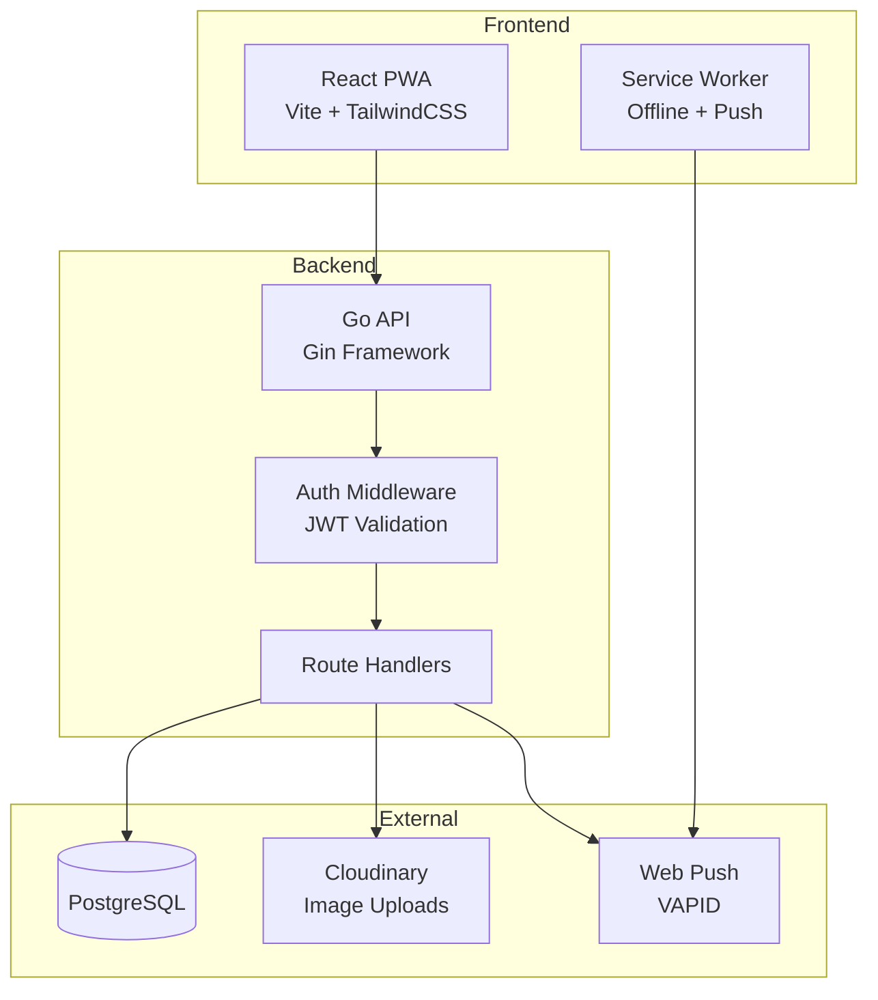
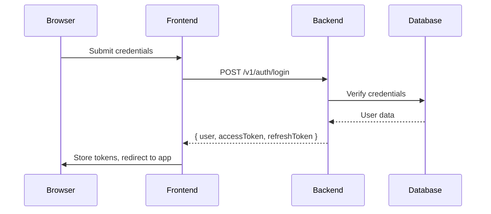
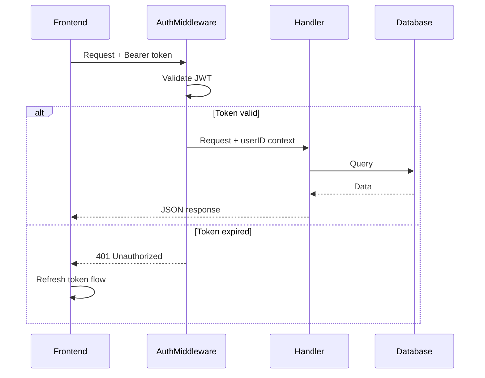
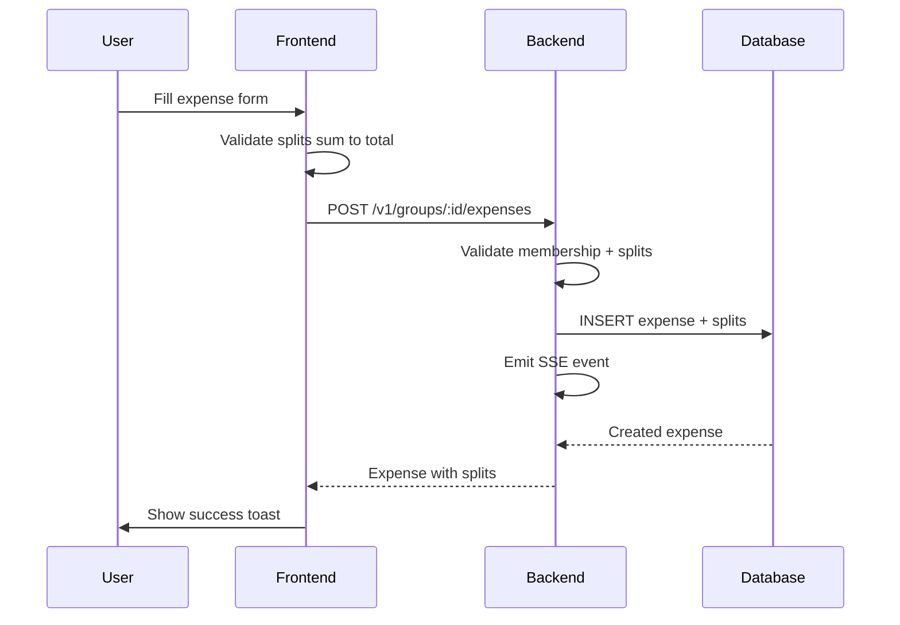
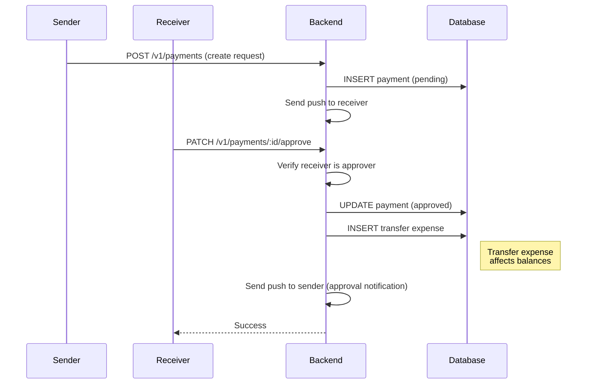
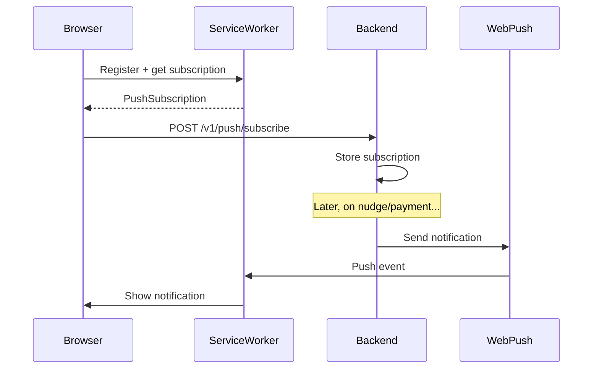

# Architecture

> System design and data flow for PayUp.

---

## Keywords

`system architecture` `component design` `data flow` `request lifecycle` `microservices` `monorepo` `React frontend` `Go backend` `PostgreSQL database` `JWT authentication` `push notifications` `Cloudinary uploads`

---

## Components

| Component | Technology | Location |
|-----------|------------|----------|
| Frontend | React 19 + Vite + Tailwind + React Query | `frontend/` |
| Backend API | Go + Gin | `backend/` |
| Database | PostgreSQL 16 | External (Neon/Supabase) |
| Uploads | Cloudinary | Optional external service |
| Push | Web Push (VAPID) via `webpush-go` | Optional |

---

## Request Lifecycle

### 1. User Registration/Login

**Files involved:**
- Frontend: `frontend/src/payup/auth/AuthProvider.tsx`
- Backend: `backend/internal/handlers/auth.go`

### 2. Authenticated API Request

**Files involved:**
- Frontend: `frontend/src/payup/api/client.ts` (proactive refresh)
- Backend: `backend/internal/auth/middleware.go`

### 3. Expense Creation with Splits

**Files involved:**
- Frontend: Add expense modal
- Backend: `backend/internal/handlers/expenses.go`, `backend/internal/handlers/validation.go`

### 4. Payment Approval Flow

**Note:** Payment approval sends push notifications to the sender to notify them of approval or rejection.

**Files involved:**
- Backend: `backend/internal/handlers/payments.go`

### 5. Push Notification Flow

**Files involved:**
- Frontend: `frontend/src/payup/push/pushManager.ts`, `frontend/public/sw.js`
- Backend: `backend/internal/handlers/push.go`

---

## Source of Truth Files

| Concern | File |
|---------|------|
| API Routes | `backend/internal/server/server.go` |
| Authentication | `backend/internal/auth/*`, `backend/internal/handlers/auth.go` |
| Database Schema | `backend/sql/schema.sql` |
| SQL Queries | `backend/sql/queries/*.sql` |
| Migrations | `backend/migrations/*.sql` |
| Frontend App | `frontend/src/payup/PayUpApp.tsx` |
| OCR (Receipt Scanning) | `backend/internal/handlers/ocr.go` |
| Activity Feed | `backend/internal/handlers/activity.go` |

---

## Error Handling

| Scenario | Behavior |
|----------|----------|
| Access token expired | Frontend refreshes proactively (2min before expiry) or reactively on 401 |
| Refresh token expired | User redirected to login |
| Missing Cloudinary config | Upload endpoints return 503 |
| Missing VAPID config | Push send no-ops; subscriptions still stored |
| Missing GEMINI_API_KEY | OCR endpoint returns 503 |
| Rate limit exceeded | 429 with `Retry-After` header; frontend retries with backoff |
| Group membership check fail | 403 Forbidden |
| Payment approval by non-receiver | 403 Forbidden |

---

## See Also

- [Reference Guide](REFERENCE.md) – Feature→code mappings
- [API.md](API.md) – Request/response details
- [DATABASE.md](DATABASE.md) – Schema documentation
- [BACKEND.md](BACKEND.md) – Go patterns
- [FRONTEND.md](FRONTEND.md) – React patterns
