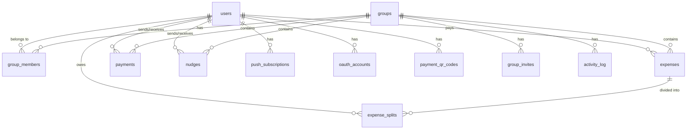

# Database

> PostgreSQL schema, tables, and relationships.

---

## Keywords

`PostgreSQL` `database schema` `tables` `relationships` `foreign keys` `migrations` `sqlc` `goose` `UUID` `numeric` `timestamps` `indexes`

---

## Overview

PayUp uses PostgreSQL with:
- **sqlc** for type-safe query generation
- **Goose** for migrations
- **UUID** primary keys
- **Numeric(12,2)** for monetary precision

---

## Entity Relationship Diagram



---

## Tables

### users

User accounts with authentication and profile.

| Column | Type | Description |
|--------|------|-------------|
| `id` | uuid | Primary key |
| `email` | text | Unique login email |
| `password_hash` | text | Nullable (OAuth users) |
| `name` | text | Display name |
| `avatar_url` | text | Profile picture URL |
| `qr_url` | text | Legacy payment QR (deprecated) |
| `created_at` | timestamptz | Account creation |
| `updated_at` | timestamptz | Last update |

---

### oauth_accounts

OAuth provider links (Google, etc.).

| Column | Type | Description |
|--------|------|-------------|
| `id` | uuid | Primary key |
| `user_id` | uuid | FK → users.id |
| `provider` | text | "google", "facebook", etc. |
| `provider_id` | text | User ID from provider |
| `email` | text | Email from provider |
| `created_at` | timestamptz | Link creation |

**Unique:** `(provider, provider_id)`

---

### groups

Expense-sharing groups.

| Column | Type | Description |
|--------|------|-------------|
| `id` | uuid | Primary key |
| `name` | text | Group name |
| `created_by` | uuid | FK → users.id (nullable) |
| `created_at` | timestamptz | Creation time |
| `updated_at` | timestamptz | Last update |

---

### group_members

Group membership with roles.

| Column | Type | Description |
|--------|------|-------------|
| `group_id` | uuid | FK → groups.id |
| `user_id` | uuid | FK → users.id |
| `role` | text | "admin" or "member" |
| `joined_at` | timestamptz | Join time |

**Primary Key:** `(group_id, user_id)`

---

### group_invites

Invite codes with expiry and usage limits.

| Column | Type | Description |
|--------|------|-------------|
| `id` | uuid | Primary key |
| `group_id` | uuid | FK → groups.id |
| `code` | text | Unique invite code |
| `created_by` | uuid | FK → users.id |
| `created_at` | timestamptz | Creation time |
| `expires_at` | timestamptz | Expiration (nullable) |
| `max_uses` | integer | Max joins allowed |
| `use_count` | integer | Current join count |

**Unique:** `code`

---

### expenses

Expense records with category and type.

| Column | Type | Description |
|--------|------|-------------|
| `id` | uuid | Primary key |
| `group_id` | uuid | FK → groups.id |
| `title` | text | Expense description |
| `amount` | numeric(12,2) | Total amount (≥0) |
| `payer_id` | uuid | FK → users.id (who paid) |
| `mode` | text | "equal", "exact", "percentage", "hybrid" |
| `type` | text | "expense" or "transfer" |
| `category` | text | "food", "transport", etc. |
| `created_by` | uuid | FK → users.id |
| `created_at` | timestamptz | Creation time |
| `updated_at` | timestamptz | Last update |

**Note:** `type='transfer'` is created when payments are approved.

---

### expense_splits

How each expense is divided among participants.

| Column | Type | Description |
|--------|------|-------------|
| `id` | uuid | Primary key |
| `expense_id` | uuid | FK → expenses.id |
| `user_id` | uuid | FK → users.id |
| `amount` | numeric(12,2) | Amount this user owes (≥0) |
| `created_at` | timestamptz | Creation time |

**Unique:** `(expense_id, user_id)`

**Constraint:** Sum of splits must equal expense amount (validated in handler).

---

### payments

Settlement transactions between users.

| Column | Type | Description |
|--------|------|-------------|
| `id` | uuid | Primary key |
| `group_id` | uuid | FK → groups.id |
| `sender_id` | uuid | FK → users.id (payer) |
| `receiver_id` | uuid | FK → users.id (payee) |
| `amount` | numeric(12,2) | Payment amount (>0) |
| `status` | enum | "pending", "approved", "rejected" |
| `proof_url` | text | Payment proof image URL |
| `decided_by` | uuid | FK → users.id (approver) |
| `decided_at` | timestamptz | Decision time |
| `created_at` | timestamptz | Request time |
| `updated_at` | timestamptz | Last update |

**Flow:** 
1. Sender creates payment (pending)
2. Receiver approves/rejects
3. On approval: transfer expense created

---

### nudges

Payment reminder notifications.

| Column | Type | Description |
|--------|------|-------------|
| `id` | uuid | Primary key |
| `group_id` | uuid | FK → groups.id |
| `sender_id` | uuid | FK → users.id (creditor) |
| `receiver_id` | uuid | FK → users.id (debtor) |
| `amount` | numeric(12,2) | Amount owed (>0) |
| `message` | text | Custom message |
| `read` | boolean | Read status |
| `created_at` | timestamptz | Send time |

---

### push_subscriptions

Web push notification endpoints.

| Column | Type | Description |
|--------|------|-------------|
| `id` | uuid | Primary key |
| `user_id` | uuid | FK → users.id |
| `endpoint` | text | Push endpoint URL |
| `p256dh` | text | Encryption key |
| `auth` | text | Auth secret |
| `created_at` | timestamptz | Subscription time |

**Unique:** `(user_id, endpoint)`

---

### payment_qr_codes

User payment QR codes for GCash, Maya, etc.

| Column | Type | Description |
|--------|------|-------------|
| `id` | uuid | Primary key |
| `user_id` | uuid | FK → users.id |
| `provider` | text | "gcash", "maya", etc. |
| `qr_url` | text | QR code image URL |
| `phone_number` | text | Associated phone |
| `is_primary` | boolean | Primary payment method |
| `created_at` | timestamptz | Creation time |
| `updated_at` | timestamptz | Last update |

**Unique:** `(user_id, provider)`

---

### activity_log

Group activity history.

| Column | Type | Description |
|--------|------|-------------|
| `id` | uuid | Primary key |
| `group_id` | uuid | FK → groups.id |
| `user_id` | uuid | FK → users.id |
| `activity_type` | text | "expense_created", "payment_approved", etc. |
| `description` | text | Human-readable description |
| `metadata` | jsonb | Additional data |
| `created_at` | timestamptz | Activity time |

**Indexes:** `group_id`, `created_at DESC`

---

## Source Files

| Purpose | Location |
|---------|----------|
| Schema for sqlc | [`backend/sql/schema.sql`](file:///c:/Users/ADRIAN/Github/skufu/PayUp/backend/sql/schema.sql) |
| SQL queries | `backend/sql/queries/*.sql` |
| Migrations | `backend/migrations/*.sql` |
| Generated Go code | `backend/internal/db/sqlcdb/` |
| sqlc config | `backend/sqlc.yaml` |

---

## Common Queries

### Get user balance in a group

```sql
-- Positive = owed money, Negative = owes money
SELECT user_id, SUM(balance) as balance
FROM (
    -- Money paid by user (credit)
    SELECT payer_id as user_id, amount as balance
    FROM expenses WHERE group_id = $1
    UNION ALL
    -- Money owed by user (debit)  
    SELECT user_id, -amount as balance
    FROM expense_splits es
    JOIN expenses e ON es.expense_id = e.id
    WHERE e.group_id = $1
) subq
GROUP BY user_id;
```

### Get pending payments for receiver

```sql
SELECT * FROM payments
WHERE receiver_id = $1 AND status = 'pending'
ORDER BY created_at DESC;
```

---

## Migration Guide

### Create new migration

```bash
cd backend
goose create feature_name sql
# Edit migrations/XXXXXX_feature_name.sql
```

### Migration format

```sql
-- +goose Up
CREATE TABLE new_table (
    id uuid PRIMARY KEY DEFAULT gen_random_uuid(),
    -- columns...
);

-- +goose Down
DROP TABLE IF EXISTS new_table;
```

### Run migrations

```bash
goose postgres "$DATABASE_URL" up      # Apply all
goose postgres "$DATABASE_URL" down    # Rollback one
goose postgres "$DATABASE_URL" status  # Check status
```

### Update sqlc

After schema changes:

```bash
cd backend
sqlc generate
```

---

## See Also

- [Reference Guide](file:///c:/Users/ADRIAN/Github/skufu/PayUp/docs/REFERENCE.md) – Feature→code mappings
- [BACKEND.md](file:///c:/Users/ADRIAN/Github/skufu/PayUp/docs/BACKEND.md) – Go patterns
- [API.md](file:///c:/Users/ADRIAN/Github/skufu/PayUp/docs/API.md) – Request/response formats
